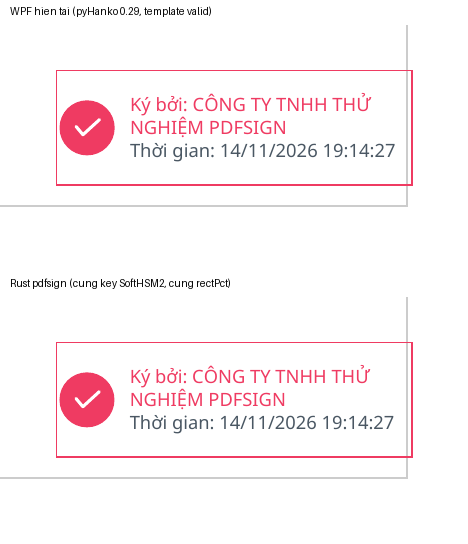
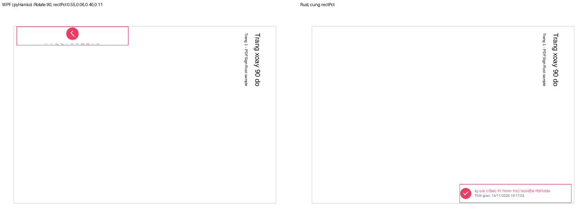

# So sánh chữ ký: WPF hiện tại (pyHanko) và pdfsign Rust

Cách tạo (tái lập bằng `scripts/compare-pyhanko.sh`):

- Cùng file `tests/fixtures/sample.pdf`, cùng khóa RSA 2048 nạp vào SoftHSM2 (PKCS#11), cùng
  `page=LAST`, `rectPct=0.55,0.06,0.40,0.11`, mẫu `valid`.
- (a) Chạy đúng mã production `desktop-signer/sign_core.py` (bản trong `PDFSignProSignerCore.exe`) với
  pyHanko 0.29.0 (bản cuối còn `_pull_cert` mà code cần), python-pkcs11 0.8.1.
- (b) `pdfsign sign --module libsofthsm2.so --pin-stdin`.
- Dump cấu trúc bằng `scripts/dump_signature.py`, kiểm tra bằng `pyhanko sign validate --trust ca.cert.pem`.

## Kết quả

| Tiêu chí | WPF (pyHanko 0.29) | Rust `pdfsign` |
|---|---|---|
| `pyhanko sign validate` | VALID, phủ toàn file | VALID, phủ toàn file |
| SubFilter | `adbe.pkcs7.detached` | `ETSI.CAdES.detached` |
| Mức chuẩn | CMS/PKCS#7 tách rời (không phải PAdES baseline) | PAdES B-B; B-T khi có `--tsa` |
| Digest / chữ ký | SHA-256 / `sha256_rsa` | SHA-256 / `sha256_rsa` |
| Signed attributes | content-type, signing-time, cms-algorithm-protection, message-digest, signing-certificate-v2 | content-type, cms-algorithm-protection, message-digest, signing-certificate-v2 |
| ESSCertIDv2 | SHA-256 + issuerSerial | SHA-256 + issuerSerial |
| Thời điểm ký | thuộc tính signing-time + `/M` UTC (`D:...Z`) | chỉ `/M`, giờ +07:00 (PAdES cấm signing-time) |
| Unsigned attributes | không | không (B-B) / signature-time-stamp-token (B-T) |
| Chứng thư trong CMS | cert người ký, bị lặp 2 lần | cert người ký + chuỗi CA có trên token, không lặp |
| Dung lượng dành cho /Contents | 4.537 byte (vừa khít) | 4.010 byte (2 KB + 2x cert; +12 KB nếu có TSA) |
| Byte gốc của PDF | bị ghi lại toàn bộ bằng pikepdf rồi mới thêm update | giữ nguyên, chỉ nối 1 incremental update |
| Kích thước file đầu ra (mẫu 1,2 KB) | 27.023 byte | 19.088 byte |
| Widget `/Rect` | `[336.6 47.52 581.4 134.64]` | `[336.6 47.52 581.4 134.64]` (trùng) |
| Widget `/F` | 132 (Print + Locked) | 132 |
| Font của stamp | Helvetica + NotoSans TrueType (qua reportlab) | NotoSans Type0/CIDFontType2, subset, có ToUnicode |
| LTV / DSS | không | không (để giai đoạn sau) |
| Trang `/Rotate 90` | khung ký sai góc, chữ bị xoay ngang | đúng góc, chữ đứng thẳng |

Hai file đều qua `pdfsig` (poppler) với "Signature is Valid" và "Total document signed".
Ký chồng bằng Rust lên file do WPF ký: pyHanko vẫn báo cả 2 chữ ký VALID, chữ ký 1 có
"All modifications relate to signing and form filling".

## Hình thức hiển thị

Cùng `rectPct`, trang thường: gần như giống hệt.

Trang `/Rotate 90` (lỗi của bản WPF, xem `ANALYSIS.md` mục 5):

## Ý nghĩa với Adobe Reader

- `adbe.pkcs7.detached` vẫn được Adobe chấp nhận, nhưng Adobe sẽ ghi định dạng là PKCS#7, không phải
  "CAdES/PAdES". Các hệ thống yêu cầu PAdES (ví dụ ETSI EN 319 142-1, kiểm định của một số cơ quan) sẽ không
  coi bản WPF là PAdES.
- Việc Adobe báo "chữ ký hợp lệ, danh tính tin cậy" phụ thuộc chuỗi CA (AATL hoặc kho chứng thư Windows),
  không phụ thuộc SubFilter. Bản Rust nhúng chuỗi CA nếu token có lưu, giúp Adobe dựng chuỗi dễ hơn.
- Không bản nào có LTV: sau khi chứng thư hết hạn, Adobe sẽ không xác minh được trừ khi có B-T + DSS (B-LT).
